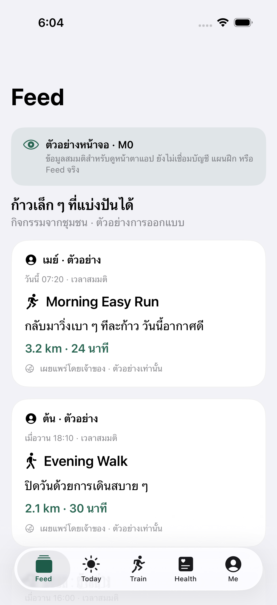
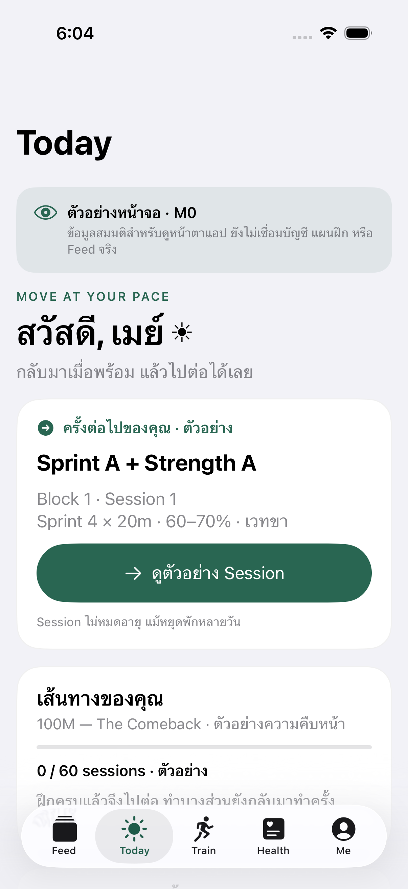
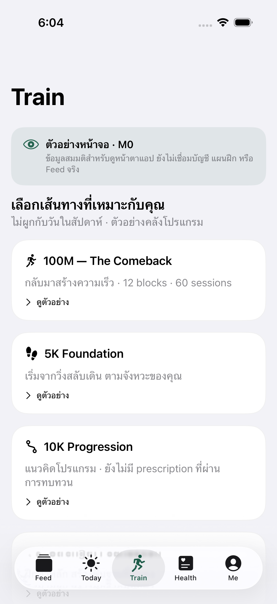
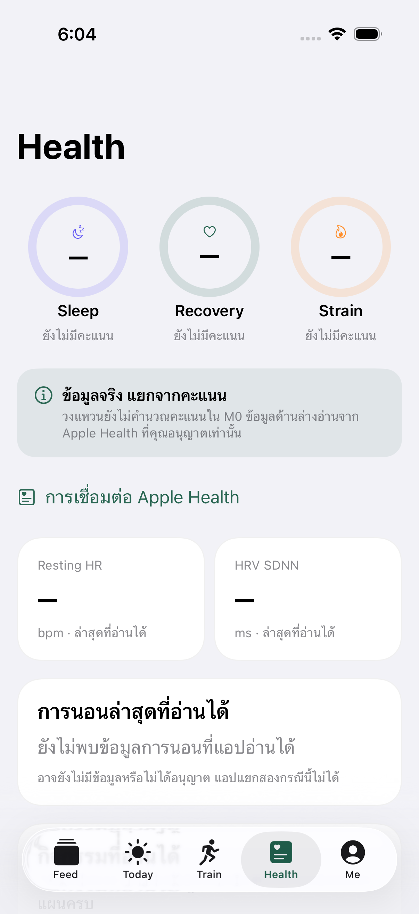
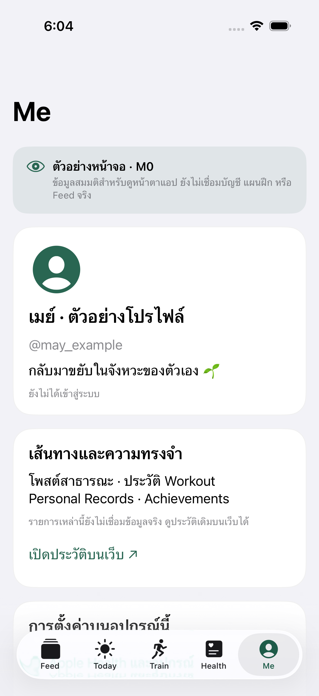

# M0 simulator screen review

Original 1206×2622 simulator attachments from head `939965577a38032dedca2ae75955a23a83402529`, tested via PR merge `cbfa8db1c55f84913cc44f370295f812e0944813`, [run](https://github.com/ijennyRSM/project-100m-dashboard/actions/runs/43072638314), [artifact](https://github.com/ijennyRSM/project-100m-dashboard/actions/runs/43072638314/artifacts/13882250468). iPhone 17 Pro / iOS 26.4 Simulator. Hashes/original attachment IDs: provenance.json. No edits, real user health records or private location data.

These capture labeled fictional feature previews and missing Health readings. The source run passed three tests and reached navigation retention in the fourth, then was superseded during relaunch. **Screenshots are UI evidence, not a full-suite PASS or device acceptance.** Subsequent commits improve large-text ring geometry; consult CURRENT for latest run evidence.

Codex inspected all five light screenshots: layout fits full device bounds, sample labels are visible within content, Feed/Today/Train/Health/Me order is correct, Health rings show missing values and Me has none. Dark/AX5 inspection revealed fixed ring geometry overflow, subsequently corrected; final corrected geometry still needs current-run evidence. Full VoiceOver, smaller-width and device review remain open.

| Feed | Today |
|---|---|
|  |  |

| Train | Health | Me |
|---|---|---|
|  |  |  |
